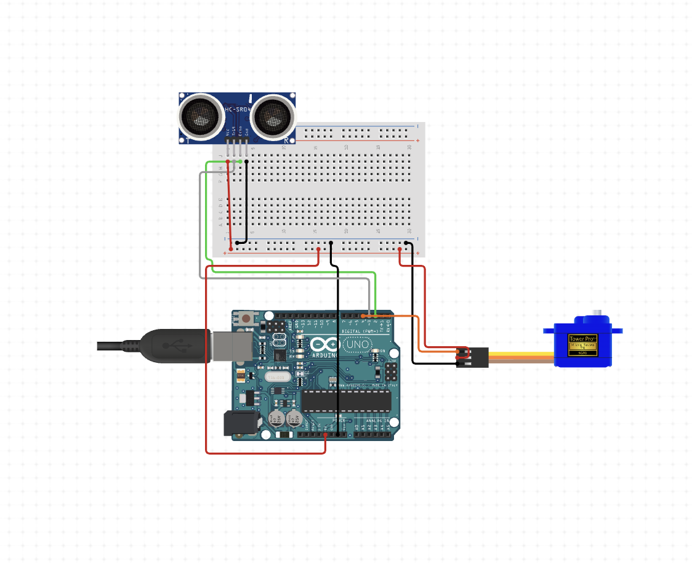
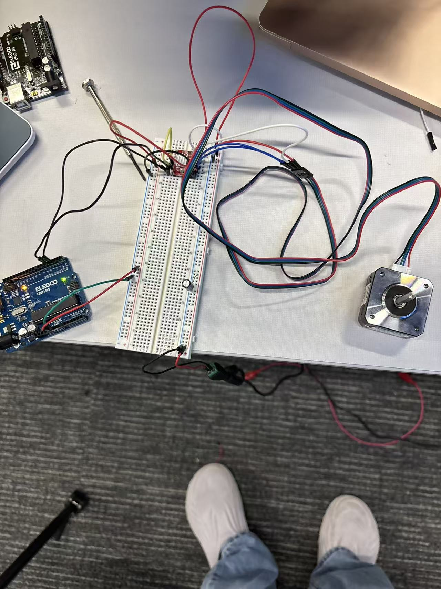
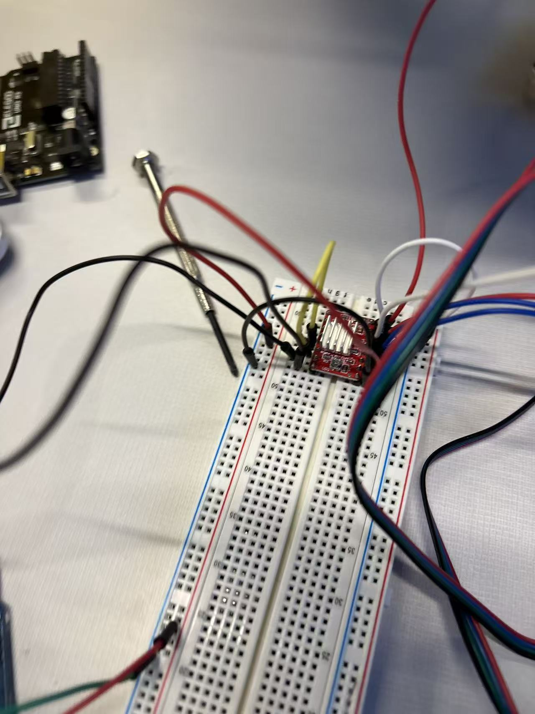
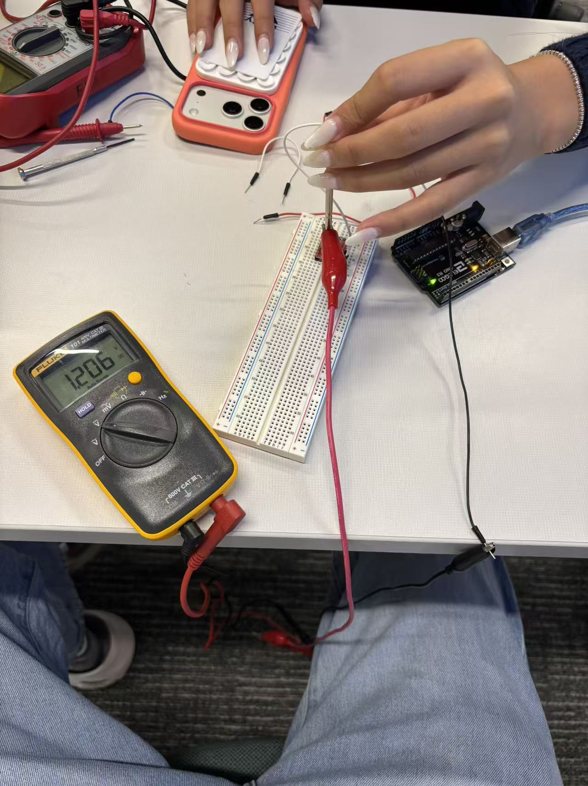
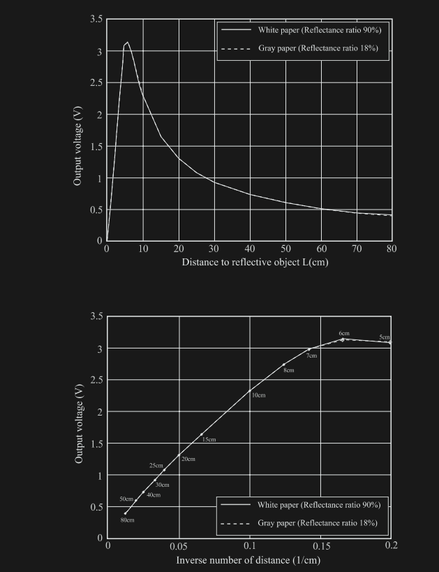

[← Back to my homepage](https://MatthewMa11.github.io/)

# Arduino 3D Scanner — Innovator Journal

Entry 1: Spinning 2D scanner  
Minimum testable prototype

## My goal for this prototype

For the first stage of my 3D scanner project, I am working toward a simple spinning 2D scanner using an Arduino Uno, an SG90 servo, and an ultrasonic distance sensor. My goal is to turn the sensor, measure distance at different angles, and send the readings to a computer.

This is my minimum testable prototype: a small version that lets me check whether movement and distance sensing work together before adding more complexity. The SG90 sweeps back and forth across a limited angle rather than rotating continuously. This first entry records the initial code and the tests I plan to carry out.

## Components and wiring

| Component or signal | Purpose or connection |
| --- | --- |
| Arduino Uno | Controls the scan and sends readings over USB |
| SG90 servo | Turns the sensor through the scanning plane |
| Servo signal | Arduino D9 |
| Ultrasonic sensor TRIG | Arduino D7 |
| Ultrasonic sensor ECHO | Arduino D6 |
| Ground | Sensor and servo supply share Arduino GND |
| Sensor mount and base | Keep the sensor aligned and the scanner steady |

The trigger and echo pins in my code are for an ultrasonic distance sensor. I need to confirm its model and power requirements when wiring it. The servo also needs a suitable power supply and a common ground with the Arduino.

### My wiring setup

I used circuitio.io to help me wire the SG90 servo motor to the Arduino Uno. I used its wiring guidance as a reference for connecting the motor to the board. The diagram below documents my wiring setup.



*This diagram shows how I wired the Arduino Uno, HC-SR04 ultrasonic distance sensor, and SG90 servo using a breadboard.*

## Development process

I used ChatGPT to generate the initial Arduino code for this prototype. The AI-generated code gave me a starting point for moving the servo, taking distance readings, and sending the results to the computer. I then reviewed how the code works, as explained below, and planned tests to check it with my hardware.

The code follows a simple sequence: move the servo, wait briefly, measure distance, and print the result. Keeping these steps together makes it easier to understand how each reading relates to the direction of the sensor.

My loop runs from -90° to +90° in 2° steps. Adding 90 to the scan angle converts that range into servo commands from 0° to 180°. This gives 91 measurement positions in a sweep. I will check the actual usable range once the sensor is mounted.

After each move, the code waits 50 milliseconds before taking a reading. That delay is a starting point to test; the sensor must settle before its measurement is useful.

## Code explanation

The Arduino sends a short pulse through the trigger pin, then measures the echo pulse with pulseIn. The calculation multiplies the echo time by 0.0343 and divides by two to estimate distance in centimetres. The division accounts for sound travelling to the object and back.

The program prints each measurement as angle,distance at 115200 baud. These pairs will let me plot a 2D scan on the computer.

### My initial code

```cpp
#include <Servo.h> 
 
Servo s; 
int trig = 7, echo = 6; 
 
void setup() { 
  Serial.begin(115200); 
  s.attach(9); 
  pinMode(trig, OUTPUT); 
  pinMode(echo, INPUT); 
} 
 
void loop() { 
  for (int a = -90; a <= 90; a += 2) { 
    s.write(a + 90); 
    delay(50); 
 
    digitalWrite(trig, LOW); 
    delayMicroseconds(2); 
    digitalWrite(trig, HIGH); 
    delayMicroseconds(10); 
    digitalWrite(trig, LOW); 
 
    long t = pulseIn(echo, HIGH); 
    float d = t * 0.0343 / 2; 
 
    Serial.print(a); 
    Serial.print(","); 
    Serial.println(d); 
  } 
}
```

## Testing and documenting the prototype

My first test will use a flat object at a known distance. I will compare the sensor reading with a ruler measurement, repeat the scan, and check whether changing the object's position changes the readings as expected.

I will also check the servo's return movement. At the end of the sweep, the code commands it back from 180° to 0°. That large movement may need more settling time than the smaller scan steps. A missing echo is another case to check because the current code can print zero when pulseIn times out.

## Reflection and next steps

Reviewing this code helped me understand how a loop can connect motor movement with sensor input. A distance reading becomes more useful when I know the angle at which it was taken. I also learned why timing matters: the servo needs time to move, and the sensor needs time to receive an echo.

This prototype measures one scanning plane. My next step is to test that plane reliably and plot the readings. Later entries will document improvements and the additional controlled movement needed to build toward a 3D scanner.


## Entry 2: Stepper motor troubleshooting and infrared sensor wiring

In this stage of our 3D scanner project, we worked on a stepper motor circuit and a Sharp infrared distance sensor separately. Our main progress was getting one stepper motor running after about two classes of troubleshooting. We also prepared the sensor wiring and learned how its output relates to distance.

### Our first motor attempt and the damaged driver

First, we connected the entire stepper motor circuit without setting the driver's current limit. When we powered it, the driver burned out and produced smoke. Some wires became hot enough for their insulation to melt, and several stuck together. We quickly unplugged the circuit.

We suspected that leaving the current limit unset allowed too much current and contributed to the failure. This was our working explanation, rather than a confirmed diagnosis. The smoke and melted insulation showed that something was seriously wrong, but those observations alone could not tell us whether the cause was the current setting, a wiring fault, or another electrical problem.

This experience taught us that checking whether the wires are connected is only part of preparing a circuit. We also need to check the driver's settings before running the motor. Any damaged wires need replacing before another test, and wiring changes should be made with power disconnected.

### Overall motor, driver, and Arduino connections



*Our motor test setup, showing the Arduino, breadboard-mounted driver, and stepper motor.*

We used two separate power rails on the breadboard. One rail received **12 V from an external power supply** for the motor side of the driver. The other received **5 V from the Arduino** for the driver's logic side. The Arduino sends the control signals, while the driver switches current through the motor's coils using the external supply. This separates the motor's power needs from the Arduino's control role, as shown in [Pololu's A4988 wiring guide](https://www.pololu.com/product/1182#power-connections).

| Connection | Role in our setup |
| --- | --- |
| External 12 V rail | Supplies the driver's motor-power input, VMOT |
| Arduino 5 V rail | Supplies the driver's logic-power input, VDD |
| Common ground | Joins the external supply negative, driver GND, and Arduino GND so the control signals have the same reference |
| Arduino control wires | Carry STEP and DIR signals to control movement |
| Motor wires | Connect the motor's two coils to the driver's outputs |

The **12 V and 5 V positive rails stay separate**. Sharing ground does not mean joining the two positive supplies. The 12 V motor supply must not be connected to the Arduino's 5 V pin or the driver's logic inputs.

### Why we connected SLEEP and RESET



*Close-up of the driver wiring. We linked SLEEP and RESET with a jumper as part of getting the motor working.*

We found that the motor would not run in our setup until we connected the driver's **SLEEP and RESET pins to each other**. These pins control whether the driver is ready to operate, so supplying power and sending movement commands is not enough by itself.

On an A4988-type driver, both inputs are **active LOW**. A LOW on SLEEP puts the chip into a low-power state and turns off the motor outputs. A LOW on RESET resets the internal step sequence, turns off the outputs, and causes STEP commands to be ignored. Both pins must therefore be HIGH for normal stepping. These functions are described in the [Allegro A4988 data sheet](https://www.allegromicro.com/-/media/files/datasheets/a4988-datasheet.pdf).

On an A4988 carrier with a pull-up on SLEEP, linking RESET to SLEEP also brings RESET HIGH instead of leaving it floating at an undefined voltage. [Pololu describes this connection](https://www.pololu.com/product/1182#control-inputs) for its carrier. An undefined or LOW RESET signal is a likely explanation for why our motor did not respond before we added the jumper.

The important condition is that **both pins are held HIGH at the correct logic voltage**. Joining two pins that are both LOW would still leave the driver unable to run; holding them HIGH separately is another valid arrangement. In our 5 V logic setup, these control pins belong to the logic side, not the 12 V motor rail. This helped us understand why one small control connection could stop the whole motor circuit from working.

### Setting the driver with a multimeter

We switched to another driver and used a multimeter while adjusting the small screw on the driver's potentiometer. We set the meter to measure DC voltage, connected the black probe to GND, and connected the red probe to the metal part of a screwdriver touching the adjustment screw. To adjust the current limit, we rotated the screwdriver to turn the potentiometer screw while watching the voltage reading.

For our motor and driver setup, we adjusted the reference voltage to approximately **1.2 V**. The multimeter in the photo reads **1.206 V**, which is close to our 1.2 V target.



*Our driver adjustment setup, with the multimeter showing approximately 1.2 V.*

The voltage used for this adjustment is called the reference voltage, or VREF. It is used to set the current limit; the meter is not directly measuring the motor current in this setup. The correct VREF depends on the particular driver board and the motor's rated current. For example, [Pololu's A4988 documentation](https://www.pololu.com/product/1182#current-limiting) explains how its reference voltage relates to the limit. We need to use the instructions for our actual driver rather than copy a voltage from a different board.

Because our red probe was connected through a metal screwdriver, careful contact mattered. Touching a nearby pin with the screwdriver could create a short circuit. This made the adjustment more delicate than simply turning a screw.

### Why the reading kept showing zero

One of the most frustrating parts was repeatedly getting a reading of zero. We kept trying to understand why the value would not change, and eventually found that one of the drivers we were using was broken. Changing to a working driver allowed us to continue. After about two classes of attempts, we finally got the motor running.

For us, the faulty driver was an important part of the problem. A zero reading by itself is not enough to identify a broken driver, though. Next time, we should check the meter's DC voltage setting, the power supply, the ground connection, and whether the probes are actually touching the correct points before deciding to replace a component.

The lesson was to test our assumptions one at a time. We had spent a long time expecting an adjustment to work on hardware that could not give us the reading we needed.

### Our first successful motor test

We ran one test program generated with ChatGPT and successfully operated one stepper motor. The program gave us a way to test movement before combining it with distance sensing. ChatGPT supplied the test code, while our work involved connecting the hardware, adjusting the driver, troubleshooting the zero reading, and testing the motor in class.

This is our current motor milestone: one motor has run with a test program. We still need to test repeatable movement and connect that movement to the sensor measurements before we have a working scanner.

### Connecting the Sharp sensor separately

We also worked on a Sharp infrared distance sensor marked **2Y0A21 F 62 A**. We connected its three wires to the Arduino as follows:

| Sensor wire | Arduino connection | Purpose |
| --- | --- | --- |
| Red | 5V | Sensor power |
| Black | GND | Ground reference |
| White | An analog input pin | Sensor output signal |

The ends of the sensor wires were still covered by insulation. We used scissors to carefully strip off enough insulation to expose the metal conductors. Then we inserted each exposed wire into the female end of a male-to-female jumper wire and secured the joint with electrical tape. We plugged the male ends into the Arduino connections listed above.

This let us connect the sensor for our prototype. It also showed us why the physical connections matter: tape holds the joint in place, but the metal conductors still need firm contact. For a more permanent version, we should use proper connectors or soldered, insulated joints so movement does not loosen the wires. Wire strippers would also give us more control than scissors.

### How the infrared sensor measures distance

The sensor sends out infrared light, which reflects from an object and enters a receiver. It uses **triangulation**: as the object's distance changes, the reflected light reaches a different position on a position-sensitive detector inside the sensor. Internal electronics turn that information into an analog output voltage. It does not use the ultrasonic echo timing from our first prototype. The [Sharp GP2Y0A21YK0F data sheet](https://global.sharp/products/device/lineup/data/pdf/datasheet/gp2y0a21yk_e.pdf) describes this sensor family and specifies a measuring range of **10 to 80 cm**.

The Arduino's analog input reads the output signal. To use that signal for scanning, we will need to convert it into a distance and check the result against known measurements.

### What the distance graph tells us



*Sharp sensor response curves for white and gray paper. These are reference curves, not measurements collected by our group.*

In the upper graph, the output voltage generally decreases as distance increases through the 10–80 cm measuring range. The curve is not straight, so the same voltage change does not represent the same distance change everywhere. Below about 10 cm, the curve turns around, meaning a very close object can produce a voltage similar to a farther object. We should therefore keep objects within the specified measuring range.

The lower graph plots voltage against inverse distance, or 1/distance. This makes much of the useful range look closer to a straight line and helps explain why a simple linear voltage-to-distance conversion would not fit the upper graph well. The white-paper and gray-paper curves also remind us to check readings on different surfaces when we calibrate our own setup.

### Reflection and next steps

Our biggest achievement so far is getting one stepper motor running after a failed driver and several frustrating attempts. We learned that a working program cannot compensate for damaged hardware or an incorrect driver setup. We also learned to separate the motor and sensor work so that we can understand each part before combining them.

Next, we plan to secure the sensor connections, record its readings at known distances between 10 and 80 cm, and compare repeated measurements. Then we can combine controlled motor movement with sensor readings and record each distance alongside its position. That will move the project from separate component tests toward an actual scanning system.

